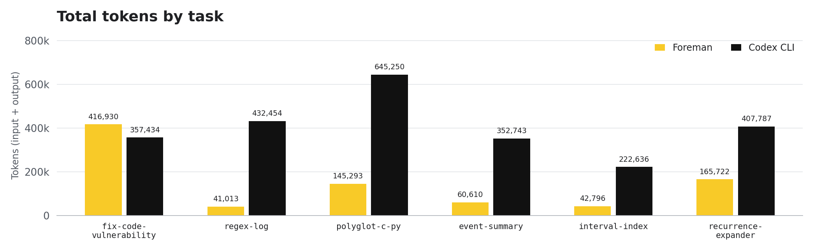
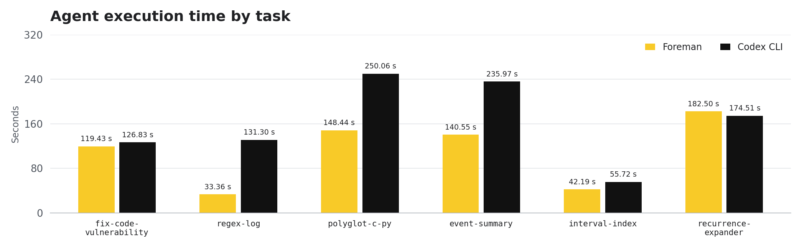
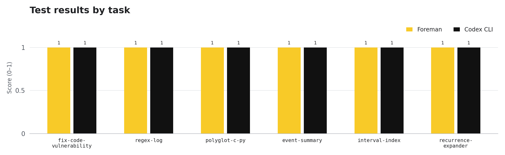

<div align="center">
  
  <h1>Open Foreman</h1>
  <p><strong>A desktop UI for the pi coding agent.</strong></p>
  <p>Bring pi's real conversations and tool execution into a workspace for managing projects, configuring models, controlling permissions, and reviewing code changes.</p>
  <p>
    <a href="README.zh-CN.md">简体中文</a>
  </p>
  <p>
    <a href="https://github.com/xujunhao940/openForeman/stargazers"></a>
    <a href="https://github.com/xujunhao940/openForeman/network/members"></a>
    <a href="https://github.com/xujunhao940/openForeman/issues"></a>
  </p>
  <p>
    
    
    
  </p>
</div>

## 🚀 Getting started

**Requirements:** Node.js 22.19+ and Yarn 4.5.3.

```sh
yarn install
yarn dev
```

1. Add a project with an absolute directory path, or choose a folder.
2. In **Settings → Providers**, add an OpenAI-compatible provider, save its API key, and fetch models.
3. Enable a model in **Settings → Models**, then select it in the chat composer.
4. Choose **Build**, **Plan**, or **Review**, send a message, and approve requested actions in the conversation.

Providers use the OpenAI Chat Completions protocol, including custom base URLs and local keyless endpoints. API keys are stored in Electron's system-encrypted credential store and passed to pi through in-memory auth overrides. They are not sent through agent IPC or written to pi auth files. Reasoning is off by default for compatibility. Context and output limits use conservative defaults of 128k and 16k tokens rather than provider metadata.

The browser preview renders the UI and can preview plugin settings. File access and agent execution require Electron. Preview settings are separate from desktop runtime configuration.

## 🧰 Capabilities

### ⚡ Foreman Mode

Foreman Mode overclocks parallel Subagents. Before investigating or answering, the main agent must launch at least two useful, independent, read-only research tasks in parallel, each with a distinct deliverable. The concurrency limit scales with reasoning effort: 3 at Low, 6 at Medium, 9 at High, and 12 at Xhigh. Child agents cannot delegate.

All ten capabilities below ship as application code and remain part of the pi runtime. The **Plugins** page lists global Skills and MCP servers. Set default permissions in **Settings → Permissions**, or override permissions for the current conversation in the prompt input. Configuration changes take effect on the next run and are blocked while a run is active.

Project details open from a project row in the sidebar. The panel includes the project name, available models, memories, checkpoints, and discovered skills. Project skills are enabled automatically. Add a global skill folder through **Plugins → Add global skill** to use it across projects. Global skills can be disabled or removed without deleting their source files. Reasoning effort is selected with a stepped slider beside the model selector in the composer menu. The composer reports the active session's context-window estimate, using model token usage when available and message length as a fallback.

| Capability | What it does |
| --- | --- |
| Subagents | The main agent handles single tasks in every mode. Delegation requires at least two independent, read-only assignments with different deliverables, launched in parallel. Foreman Mode scales concurrency with reasoning effort. Children cannot delegate. |
| Plan mode | `update_plan` publishes ordered steps. Plan mode blocks file writes, shell commands, memory writes, and MCP operations before execution. |
| Permissions | Ask, Approve for me, Read only, and Allow all modes. Ask requires per-call approval for writes, shell, web, and MCP. Approve for me uses the selected model to review actions and asks the user when review does not approve. Approval expires after five minutes and is cancelled when a run stops. Disabling the capability blocks sensitive tools. |
| Checkpoints | File snapshots are saved before and after each run, outside the project. Unchanged snapshots are reused. Git repositories include tracked and non-ignored files; other folders exclude build and dependency directories. |
| Memory | Explicit per-project notes can be edited in the UI or through the permission-gated `memory` tool. Notes are injected into subsequent sessions. |
| Web access | `web_fetch` retrieves public HTTP(S) text, HTML, or JSON. DNS is checked and pinned, redirects are revalidated, and requests have a 30-second timeout and 1 MiB response limit. It does not provide search-engine results or browser automation. |
| MCP | Discovers and calls tools over stdio and Streamable HTTP. Configure servers in Plugins. Connections and calls require permission and are treated as mutating, so they are unavailable in Plan, Review, and Read only modes. |
| Modern Web Guidance | Bundles Google's `modern-web-guidance` and `chrome-extensions` skills with local search and guide retrieval tools. Volatile and Origin Trial guides require explicit `.mwgrc` opt-in. |
| Undo and redo | Restores workspace files between checkpoints after checking all affected paths for conflicts. Unrelated files are preserved. Controls appear at the end of an assistant response only when workspace files changed, and each response targets its own before and after snapshots. Requires Checkpoints and does not restore model conversation history. |
| Review | A file browser shows staged and unstaged changes against HEAD, untracked file content, per-file counts, line numbers, and colored additions and deletions. Review with agent starts a read-only inspection. |
| Skills | Includes the bundled Modern Web Guidance and Chrome Extensions skills, plus project `.pi/skills`, `.agents/skills`, and registered global skill folders. Skills appear in the UI and pi system prompt. `/skill:name` invokes discovered instructions. Arbitrary project extension code is not loaded automatically. |

## 📊 Terminal-Bench snapshot

Seven tasks · Same model and reasoning effort for both agents · `gpt-6.2-sol (xhigh)`







Details and reproduction instructions are in [`benchmarks/terminal-bench/README.md`](benchmarks/terminal-bench/README.md).

## 🔐 Security and limits

The shell is an approved local shell, not an OS sandbox. File tools validate project paths and symlinks. Approving a shell or MCP server can grant access outside the workspace. Read only blocks these operations. External network effects, shell changes outside the project, and MCP effects cannot be undone by file checkpoints.

Checkpoints stop if they encounter unsupported files rather than silently omitting them. Limits are 4,000 files, 8 MiB per file, and approximately 36 MiB total. Symlinks and non-regular files are rejected. Exclude large generated artifacts before using an agent. Snapshots may contain source-code secrets and are stored with owner-only permissions. Automatic checkpoint retention cleanup is not currently available.

Only one conversation can run per project directory at a time, preventing overlapping writes and restores. Other projects can run independently. Stop cancels the root session, children, and pending approvals. pi JSONL history resumes by project and chat after restart. The renderer stores visible messages in localStorage.

## 🏗️ Architecture

| File | Responsibility |
| --- | --- |
| `electron/agent/runtime.ts` | pi lifecycle, streaming, bundled tools, and session persistence |
| `electron/agent/permissions.ts` | Execution gate and pending approvals |
| `electron/agent/storage.ts` | Project paths, atomic state, checkpoint restore and conflicts, and review diff |
| `electron/agent/mcp.ts`, `web.ts` | MCP and web adapters |
| `shared/agent.ts` | Typed IPC contract and bundled capability manifest |
| `electron/agent/ipc.ts`, `electron/preload.ts` | Electron bridge |
| `src/hooks/use-agent-events.ts` | Shared event store that survives chat navigation |
| `src/pages/project.tsx` | Conversation UI, plans, reasoning, approvals, per-response file diffs, and context usage |

Runtime configuration, workspace memory, checkpoints, and pi sessions live under Electron `userData/agent/`. Credentials should not be stored in project memory or MCP command arguments.

## 🧪 Verify and package

```sh
yarn typecheck
yarn test
yarn lint
yarn build:app             # Renderer and Electron bundles
yarn package:dir           # Unpacked app using the installed Electron
yarn build                 # Platform installer
```

`tests/agent.test.ts` runs the real pi SDK against a local SSE model fixture and a real MCP stdio fixture. It covers streaming and tool execution, permissions, read-only enforcement, persistent history and memory, subagents, capability toggles, file restore conflicts, and review. Tests require localhost and subprocess access and do not call a paid model.

pi and MCP remain external production dependencies in the Electron bundle so electron-builder includes their native modules, package resources, and dynamic imports. AI Elements are registry-installed source components adapted to the existing Base UI primitives and Gravity icons.
