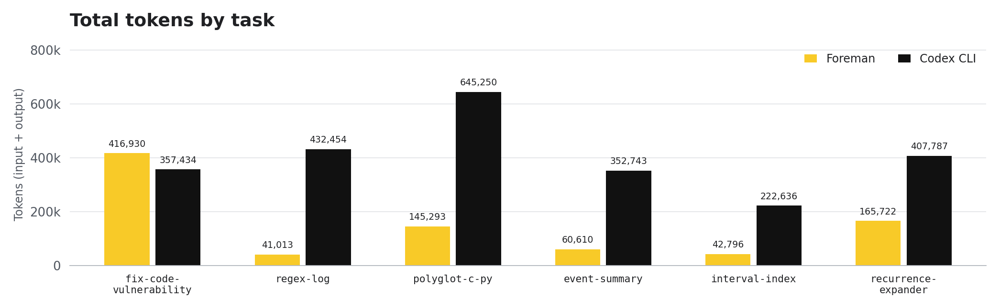
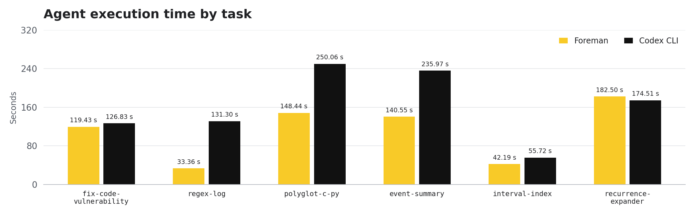
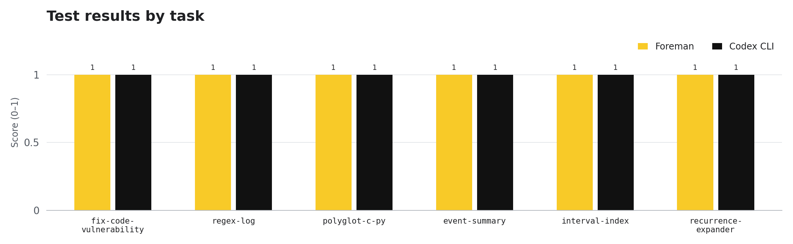

<div align="center">
  
  <h1>Open Foreman</h1>
  <p><strong>pi coding agent 的桌面 UI。</strong></p>
  <p>将 pi 的真实对话与工具执行能力带入桌面工作区，便于管理项目、配置模型、控制权限和审查代码变更。</p>
  <p>
    <a href="README.md">English</a>
  </p>
  <p>
    <a href="https://github.com/xujunhao940/openForeman/stargazers"></a>
    <a href="https://github.com/xujunhao940/openForeman/network/members"></a>
    <a href="https://github.com/xujunhao940/openForeman/issues"></a>
  </p>
  <p>
    
    
    
  </p>
</div>

## 🚀 快速开始

**环境要求：** Node.js 22.19+ 和 Yarn 4.5.3。

```sh
yarn install
yarn dev
```

1. 使用绝对路径添加项目，或选择一个文件夹。
2. 打开 **Settings → Providers**，添加兼容 OpenAI 的 Provider，保存 API Key 并获取模型列表。
3. 在 **Settings → Models** 中启用模型，然后在聊天输入框中选择它。
4. 选择 **Build**、**Plan** 或 **Review** 模式并发送消息，在对话中审批智能体请求的操作。

Provider 使用 OpenAI Chat Completions 协议，支持自定义 Base URL 和无需密钥的本地端点。API Key 保存在 Electron 系统加密的凭据存储中，并通过内存中的认证覆盖配置传递给 pi。密钥不会经过智能体 IPC 传输，也不会写入 pi 的认证文件。为兼容更多模型，推理功能默认关闭。上下文和输出长度采用保守默认值，分别为 128k 和 16k token，不读取 Provider 元数据。

浏览器预览可渲染界面和预览插件设置。文件访问和智能体运行需要 Electron。预览中的设置与桌面运行时配置相互独立。

## 🧰 功能

### ⚡ Foreman Mode

Foreman Mode 会为并行 Subagents“超频”。主智能体在自行调查或回答前，必须先并行启动至少两个有价值、彼此独立且只读的研究任务，并为每个任务设定不同的交付物。并发上限随推理强度变化：Low 为 3、Medium 为 6、High 为 9、Xhigh 为 12。子代理不能继续委派。

以下十项能力均以内置应用代码的形式提供，并作为 pi 运行时的一部分。**Plugins** 页面仅列出全局 Skills 和 MCP 服务器。可在 **Settings → Permissions** 设置默认权限，也可在提示词输入框中为当前对话覆盖权限。配置更改会在下一次运行时生效，运行期间无法更改。

点击侧边栏中的项目行可打开项目详情面板，其中包含项目名称、可用模型、记忆、检查点和发现的技能。项目技能会自动启用。通过 **Plugins → Add global skill** 添加全局技能文件夹，即可在多个项目中使用。禁用或移除全局技能不会删除其源文件。可在输入框菜单中的模型选择器旁，通过分级滑块调整推理强度。输入框会显示当前会话的上下文窗口估算值，优先使用模型提供的 token 用量，缺少时则根据消息长度估算。

| 能力 | 说明 |
| --- | --- |
| 子代理 | 所有模式下，单一任务都由主智能体直接处理。委派任务需要至少两个彼此独立、只读且交付物不同的工作，并行启动。Foreman Mode 会根据推理强度调整并发上限。子代理不能继续委派。 |
| Plan 模式 | `update_plan` 用于发布有序步骤。Plan 模式会在执行前阻止文件写入、Shell 命令、记忆写入和 MCP 操作。 |
| 权限 | 提供 Ask、Approve for me、Read only 和 Allow all 模式。Ask 要求逐次审批写入、Shell、Web 和 MCP 操作。Approve for me 会使用所选模型审查操作，审查未通过时询问用户。审批在五分钟后过期，运行停止时也会取消。关闭此能力会阻止敏感工具。 |
| 检查点 | 每次运行前后都会在项目目录外保存文件快照，并复用未变化的快照。Git 仓库包含已跟踪且未被忽略的文件；其他文件夹会排除构建和依赖目录。 |
| 记忆 | 每个项目可维护独立笔记，可在界面中编辑，也可通过受权限控制的 `memory` 工具编辑。笔记会注入后续会话。 |
| Web 访问 | `web_fetch` 获取公开 HTTP(S) 文本、HTML 或 JSON。系统会检查并固定 DNS 解析结果、重新验证重定向，并限制请求超时为 30 秒、响应体最大为 1 MiB。此功能不提供搜索引擎结果或浏览器自动化。 |
| MCP | 通过 stdio 和 Streamable HTTP 发现并调用工具。在 Plugins 中配置服务器。连接和调用均需权限，并按可能修改数据的操作处理，因此 Plan、Review 和 Read only 模式不可用。 |
| Modern Web Guidance | 内置 Google 的 `modern-web-guidance` 和 `chrome-extensions` 技能，并提供本地搜索与指南检索工具。实验性和 Origin Trial 指南需要在 `.mwgrc` 中显式启用。 |
| 撤销与重做 | 在检查点之间恢复工作区文件，并在写入前检查所有受影响路径是否冲突，同时保留无关文件。只有工作区文件发生变化时，助手回复末尾才会显示相应操作；每条回复只针对自身运行前后的快照。此功能依赖检查点，只恢复工作区文件，不恢复模型对话历史。 |
| 代码审查 | 文件浏览器会显示相对于 HEAD 的暂存和未暂存改动、未跟踪文件内容、逐文件统计、行号和彩色增删标记。使用智能体审查会启动只读检查。 |
| Skills | 内置 Modern Web Guidance 和 Chrome Extensions 技能，也会发现项目中的 `.pi/skills`、`.agents/skills` 和已注册的全局技能目录。技能会显示在界面和 pi 系统提示中，使用 `/skill:name` 调用对应说明。项目中的任意扩展代码不会被自动加载。 |

## 📊 Terminal-Bench 实测

七项任务 · 两边使用相同模型和推理强度 · `gpt-6.2-sol (xhigh)`







详细说明参考 [`benchmarks/terminal-bench/README.md`](benchmarks/terminal-bench/README.md)。

## 🔐 安全与限制

Shell 是经过批准的本地 Shell，不是操作系统沙箱。文件工具会验证项目路径和符号链接。批准 Shell 或 MCP 服务器后，相关操作可能访问工作区以外的内容。Read only 模式会阻止这些操作。检查点无法撤销外部网络影响、工作区外的 Shell 修改或 MCP 操作产生的影响。

遇到不支持的文件时，检查点会停止，而不会静默跳过。限制为最多 4,000 个文件、单个文件 8 MiB、总计约 36 MiB。符号链接和非普通文件不受支持。使用智能体前请排除大型生成文件。快照可能包含源代码中的秘密信息，并以仅所有者可访问的权限保存。目前没有自动清理旧检查点的功能。

同一项目目录同时只能运行一个对话，以避免写入或恢复操作相互重叠。不同项目可以并行运行。停止操作会取消根会话、子代理和待处理审批。重启后，pi 会按项目和对话恢复 JSONL 历史。渲染进程会将可见消息保存在 localStorage 中。

## 🏗️ 项目结构

| 文件 | 职责 |
| --- | --- |
| `electron/agent/runtime.ts` | pi 生命周期、流式输出、内置工具和会话持久化 |
| `electron/agent/permissions.ts` | 执行权限关卡和待处理审批 |
| `electron/agent/storage.ts` | 项目路径、原子状态写入、检查点恢复与冲突处理、审查差异 |
| `electron/agent/mcp.ts`、`web.ts` | MCP 和 Web 适配器 |
| `shared/agent.ts` | 类型化 IPC 契约和内置能力清单 |
| `electron/agent/ipc.ts`、`electron/preload.ts` | Electron 通信桥接 |
| `src/hooks/use-agent-events.ts` | 在聊天导航间保持状态的共享事件存储 |
| `src/pages/project.tsx` | 对话界面、计划、推理过程、审批、逐回复文件差异和上下文用量 |

运行时配置、工作区记忆、检查点和 pi 会话保存在 Electron 的 `userData/agent/` 目录下。请勿将凭据保存在项目记忆或 MCP 命令参数中。

## 🧪 验证与打包

```sh
yarn typecheck
yarn test
yarn lint
yarn build:app             # Renderer 和 Electron 构建产物
yarn package:dir           # 使用已安装 Electron 打包未安装目录
yarn build                 # 平台安装包
```

`tests/agent.test.ts` 使用真实 pi SDK，连接本地 SSE 模型测试夹具和真实 MCP stdio 测试夹具。测试覆盖流式输出与工具执行、权限控制、只读限制、历史和记忆持久化、子代理、能力开关、文件恢复冲突和代码审查。测试需要访问 localhost 并启动子进程，不会调用付费模型。

pi 和 MCP 作为外部生产依赖保留在 Electron 包中，以便 electron-builder 正确打包其原生模块、包资源和动态导入。AI Elements 是通过组件注册表安装的源代码组件，并适配了现有 Base UI 原语和 Gravity 图标。
